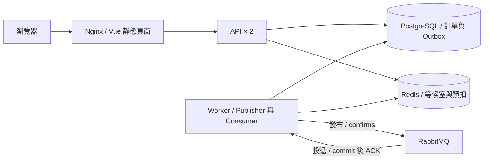

# Encore

*A ticketing platform demo with a waiting room, asynchronous checkout, and QR ticket check-in.*

Encore 是面向活動主辦方、購票者與驗票人員的售票平台展示作品，涵蓋活動發布、排隊、保票、模擬付款到入場驗票。
專案聚焦多人競爭有限票額、非同步處理與故障重送時的資料一致性；付款皆為模擬，不涉及真實收款。

## 展示

- [線上沙盒 encore.jackteng.dev](https://encore.jackteng.dev)：可實際排隊購票、模擬付款、領取電子票券，並用員工後台（`/staff/login`）建立活動與驗票入場。活動與訂單皆為虛構，每天 04:10（台北時間）自動重置。
  - 觀眾：`demo-fan` / `encore-demo-customer`（也可自行註冊）
  - 員工：`manager` / `encore-demo-manager`
- 沙盒與正式部署使用相同版本；為了讓每位訪客都能使用，停用活動封存。
- 完整互動流程也可依[展示操作手冊](docs/SHOWCASE.md)在本機以合成資料重現。

## 主要功能

- 活動、場次與票種管理，包含發布、封存、版本檢查與操作稽核。
- 等候室、會員限流與短效購票資格；非同步購票請求可查詢進度並恢復原操作。
- PostgreSQL 保票、限購、取消與到期釋放；Redis Lua 預扣、有限返還及人工核對流程。
- 模擬付款、電子票券領取與 QR 顯示；員工核對後執行一次性驗票、撤銷與場次入場時間窗管理。
- 顧客與員工獨立登入、員工讀寫角色，以及節點心跳、待處理工作與依賴服務的唯讀監控。

## 技術架構

| 層 | 技術 |
|---|---|
| 前端 | Vue 3、TypeScript、Vue Router、Vite |
| API／背景工作 | Java 21、Spring Boot、Spring Security、Spring JDBC；同一 JAR 的 API／Worker profiles |
| 正式資料 | PostgreSQL、Flyway |
| 入口控制／預扣 | Redis、Lua |
| 非同步傳遞 | RabbitMQ、Transactional Outbox、publisher confirms |
| 執行與交付 | Nginx、Docker Compose、GitHub Actions、私有 GHCR |

以下為 [Compose 部署](infra/compose.deploy.yml)的執行元件；Worker 可依[多 Worker 文件](docs/MULTI_WORKER.md)擴為兩個實例。



## 工程重點

- **有限票額的一致性**：PostgreSQL 裁定正式票額、限購與訂單；Redis Lua 處理預扣，持久化 intent、decision 與恢復工作協調跨系統結果，狀態不明時以 gate 阻擋新預扣。[預扣設計](docs/STOCK_CHECKOUT.md)
- **至少一次投遞與去重**：受理請求與 outbox 同交易寫入，publisher 使用租約與 confirms；Consumer 在 DB commit 後 ACK，以原事件去重，容許重送而不重複建立訂單。[MQ 傳遞](docs/MQ_DELIVERY.md)
- **未知回應的操作恢復**：前端保留原 UUID 與請求內容，先查詢或重試原操作；後端核對身分與內容，避免逾時後另建重複操作。HTTP 202 僅代表受理。[非同步購票](docs/ASYNC_CHECKOUT.md)
- **跨 API 身分與權限**：顧客／員工 Cookie 與 CSRF 分離；員工 session 由 PostgreSQL 共用並可撤銷，業務交易內再次核對目前權限與稽核資料。[共用 Session](docs/SHARED_STAFF_SESSIONS.md)
- **多 Worker 故障驗證**：以真 PostgreSQL／RabbitMQ 測試競爭、重複訊息、confirm 後中斷與 commit 前停機，核對恢復後的單一業務效果。[驗證範圍](docs/MULTI_WORKER.md)

## 品質與交付

- GitHub Actions [`verify`](.github/workflows/showcase-verify.yml) 執行前端型別檢查與 production build，以及後端完整測試與隔離整合環境；使用真 PostgreSQL、Redis、RabbitMQ。
- [交接文件](docs/HANDOFF.md)記載最近一次完整 `mvn package` 為 **629 項測試／30 suites，失敗、錯誤與跳過皆為 0**，並通過前端 build。這是文件中的歷史驗證紀錄。
- 交付流程：PR → `verify` 通過 → 合併 main → main CI 成功後[發布私有 GHCR 映像](.github/workflows/homelab-release.yml) → 擁有者自架伺服器以排程拉取的 CD 自動部署；部署紀錄見[交接文件](docs/HANDOFF.md)。

## 本機啟動

需要 JDK 21、Maven 3.9、Node.js ≥ 22.12、Python 3、Docker Compose v2，以及 Bash／WSL2。以下從倉庫根目錄執行，使用全新隔離環境；生成器拒絕覆寫既有 env。

先在拋棄式環境完成測試與建置，再停止該環境：

```bash
python scripts/init_demo.py --loopback-http --env work/showcase/runtime.env
python scripts/init_mq.py --env work/showcase/runtime.env
docker compose --env-file work/showcase/runtime.env -f infra/compose.yml -f infra/compose.mq.yml up -d --wait
set -a
. work/showcase/runtime.env
set +a
mvn -f backend/pom.xml package
(cd frontend && npm ci && npm run build)
docker compose --env-file work/showcase/runtime.env -f infra/compose.yml -f infra/compose.mq.yml down
```

另建展示資料環境，啟用購票、模擬付款與票券功能後啟動：

```bash
python scripts/init_demo.py --loopback-http --env work/showcase-demo/runtime.env
python scripts/init_mq.py --env work/showcase-demo/runtime.env
docker compose --env-file work/showcase-demo/runtime.env -f infra/compose.yml -f infra/compose.mq.yml up -d --wait
set -a
. work/showcase-demo/runtime.env
set +a
export TICKET_ORDERS_ENABLED=true TICKET_PURCHASES_ENABLED=true
export TICKET_DELIVERY_ENABLED=true TICKET_PUBLISHER_ENABLED=true TICKET_CONSUMER_ENABLED=true
export TICKET_EXPIRY_ENABLED=true TICKET_ADMISSION_ENABLED=true TICKET_MOCK_PAYMENTS_ENABLED=true
export TICKET_ISSUANCE_ENABLED=true TICKET_CHECK_IN_ENABLED=true TICKET_ADMISSION_WINDOW_ENABLED=true
export TICKET_PREDEBIT_ENABLED=false
java -jar backend/target/ticket-platform-0.1.0.jar
```

另一終端執行 `cd frontend && npm run preview`，開啟 `http://127.0.0.1:15180`。此簡單模式以單一 JVM 同時執行 API 與背景工作；預扣預設關閉。
帳密留在 ignored `work/`，僅使用合成資料；停止展示時保留 volumes。完整操作、旗標與停止方式見[展示操作手冊](docs/SHOWCASE.md)，雙 API／Worker 見[部署指南](docs/DEPLOYMENT.md)。

## 已知限制

- 屬展示作品，沒有真實付款、通知、完整退款／轉讓、指定座位或離線入場，不適用正式售票營運。
- PostgreSQL、Redis、RabbitMQ 仍為單節點；多 API／Worker 位於單機，未驗證 Redis Cluster、多 broker 或跨主機高可用。
- 持續預扣尚未完成：文件中的小批量測試在 12 張票保留 8 張後進入 DIRTY gate，剩餘 4 張無法接續；不能據此宣稱持續高吞吐或最大容量。
- 真手機驗票、正式 HTTPS／可信代理、DB 最小權限與全服務備份還原仍待驗收；已有的有界 PostgreSQL 還原證據不涵蓋完整災難復原。詳見[功能現況](docs/FEATURE_STATUS.md)與[後續清單](docs/CLOUD_LOCAL_FOLLOWUP.md)。

## 文件

- [架構與資料流](docs/ARCHITECTURE.md)／[功能現況與證據](docs/FEATURE_STATUS.md)
- [展示操作手冊](docs/SHOWCASE.md)／[部署指南](docs/DEPLOYMENT.md)
- [QR 票券與驗票](docs/TICKET_QR.md)／[備份還原](docs/BACKUP_RESTORE.md)
- [最新交接](docs/HANDOFF.md)／[原 README 開發紀錄](docs/DEV_LOG.md)
