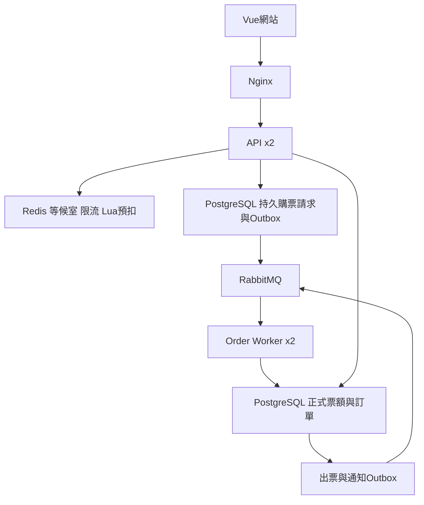

# 歷史架構（M6D前）

僅保存原2026-10-08設計及分階段更新；其中未實作／未來式不是目前狀態。原相對連結以docs/為基準，現況見[目前架構](../ARCHITECTURE.md)。

# 售票架構與決策

確認日期：2026-10-08（Asia/Taipei）。來源：使用者本輪確認的架構，以及上傳 chatgpt_chat.md 的 Redis／Queue／多實例討論。此文件保存設計，不把附件內的命令視為執行指令。

## 目標
獨立售票產品，同時展示排隊入場、Redis Lua 預扣、非同步訂單削峰、多 API/Worker、票額一致性與故障恢復。第一版票種＋數量、不指定座位；mock付款，真provider、指定座位、App另階段。核心驗收：不超賣、不重複下單或出票、重啟可恢復。

## 組成
Vue3/TypeScript/Vite 顧客與員工網站；Java21/SpringBoot模組化單體；PostgreSQL/Flyway為正式帳本；Redis等候室/限流/Lua預扣；RabbitMQ背景工作与非同步購票；同一Java專案的API與Worker模式；SeaweedFS/S3活動海報；Nginx反向代理；k6/Prometheus/Grafana壓測與觀測。採免費自架，版本鎖定與授權依实际選用版本核對。

## 模組與資料責任
Identity（顧客/員工隔離）、Catalog（活動/場次/票種）、WaitingRoom、Orders/Reservations、Payments、Tickets、Delivery（outbox/consumer）、Operations（audit/reconcile/監控）。明確服務介面，不隨意寫別模組資料。M5A員工使用同源、共享PG session與獨立cookie CSRF；原memory登入在V22切換後重新登入。兩API驗收不代表多Worker／Cluster／HA完成，見SHARED_STAFF_SESSIONS。

PostgreSQL保存容量、held、sold、訂單價格快照、expiresAt、payment、ticket、命令與不可變audit；可售=capacity-held-sold，CHECK/條件更新/唯一鍵與一致鎖順序守門。保留→待付款→已付款/已取消/已逾時；晚到成功進REVIEW，不復活或盲目釋放。出票以order/item唯一鍵去重，驗票原子轉換。

Redis是前置控制，不是帳務唯一來源。入場資格綁定顧客/場次/有效期，不等於保票。Lua原子驗資格/餘額/請求去重/預扣；多key同hash-tag/slot，事前驗型別與參數，Lua執行錯誤不提供SQL rollback。腳本短且有界；同一熱key不會因Cluster變三份。預扣台帳保留requestId、quantity、deadline、generation與狀態，不裸DECR/INCR。

## 同步基準與非同步版本
先建立同步PostgreSQL保留+訂單交易作正確性和效能基準，再加入等候室與非同步路徑；兩者共用正式交易服務，不能同時各用自己的庫存帳本。

非同步：Redis預扣→持久purchase_request+outbox短交易→confirmed RabbitMQ publish→Worker核對有效請求→DB保留/訂單/事件同交易→commit後ACK。前端初回PROCESSING，查同requestId；只有DB訂單/保留commit後才顯示待付款倒數。202不表示已保票。acceptance/reservation到期、queue延遲上限、取消與Worker競爭另以明確狀態機實作。

Redis→持久請求仍有故障窗口，outbox只解決DB→MQ。故障核對須涵蓋：预扣成功但未落DB、DBcommit回覆遺失、publish confirm未知、consumer commit後未ACK、補償重送、Redis主從切換遺失最近寫入。每一步唯一操作ID/版本/狀態防重；未知先核對，不能盲目補回。

恢復暫停新入場/預扣，用新generation從正式DB與仍有效持久請求核對重建，過期generation拒絕；不先放流再SET覆寫計數。TTL不會自動增加另一key，keyspace通知不能作可靠到期工作。DB持久期限+排程/claim支援重啟補做。Redis故障暫停新購票，既有訂單查詢/付款不得依賴暫存庫存。

RabbitMQ durable queue、persistent message、publisher confirms/returns、consumer手動ACK、有限prefetch/併發、去重、退避、死信與人工核對。至少一次、不承諾exactly-once。DB交易內不做網路寄訊/付款/MQ等待；provider未知結果留查核。後续集群使用quorum queue。

## 多實例與演練
API x2/Worker x2由同一程式不同模式啟動；寫入身分/共享session/授權明確。等候室與訂單Queue不同：前者控制進入者，後者控制正式交易速率。限購由DB核對，不只IP限流。

Redis先單節點，再3Primary+3Replica，實測拓撲/slot/Lua/failover/reconcile；Replica不是備份、WAIT不等於零遺失。RabbitMQ先單節點再3節點quorum；Docker同機可演練程序故障，不能宣稱跨主機/機房高可用。依工作負載量測requests/s、成功orders/s、P95/P99、queue age/depth、恢復時間與資料不變條件；並發人數不等於RPS，不先寫十萬併發保證。

## 六個里程碑
1. M1基礎：獨立倉庫/工作規範/員工身分/活動場次票種管理與匿名查詢、isolated PG migration、build。
2. M2交易核心：顧客身分/限購/同步保留/訂單/取消到期/mock付款，驗最後一張、重送、競爭、回滾。
3. M3流量：Redis等候室/限流/入場token/重連/故障政策。
4. M4非同步與票券：Lua預扣/持久請求/outbox/RabbitMQ/多Worker/補償核對/出票驗票；分小里程碑保存。
5. M5多實例與集群：API x2/Worker x2、共享session、Redis集群与Rabbit quorum各自profile和故障證據。
6. M6展示驗收：k6同步vs非同步基準、監控、故障演練、不變條件、完整交接與本地部署指引。

每個獨立驗證點測試/build、HANDOFF、commit/push main，不等全部完成。實作狀態以ROADMAP/HANDOFF為準。

M3已實作版本：每票種獨立等候室，短效資格保存於Redis並綁principal owner/sessionVersion，沒有可轉送bearer token；PG仍檢限購/庫存。M3只控制入口；M4A/B已完成持久購票請求/outbox及MQ，Lua票額預扣仍待後續，詳見WAITING_ROOM_API/HANDOFF。

M4A已實作：V5持久請求／原命令與唯一outbox intent同交易；PROCESSING不扣票，內部處理入口共用PG保票核心、終止／重送不復活。M4B已接租約publisher、RabbitMQ confirm/return、延遲重試/DLQ與PG commit後ACK worker；M4C已接非同步checkout／本人歷史／未知操作恢復，保留同步比較；M4D2B4 已接另個預設關閉的Lua預扣入口／原UUID進度，見 STOCK_CHECKOUT；舊PG入口見PURCHASE_API／MQ_DELIVERY／ASYNC_CHECKOUT。

M4D1已實作內部RedisTicketLedger＋單key Lua：有界非TTL收據、冪等HOLD／COMMIT／RELEASE、凍結generation不能重开、無active hold才可輪替、舊ID跨generation不重扣。沒有公開endpoint／Spring bean，也未接checkout／worker；PG持久門狀態、正式庫存協調與orphan核對留M4D2。單key操作原子不代表Redis→PG原子性，具體狀態與驗收見REDIS_TICKET_LEDGER。

M4D2A新增V7 PG epoch／重建命令／不可變庫存revision，所有正式ticket庫存及version變動由trigger同交易標DIRTY。維運先提交CLOSED，再在ticket lock內核對固定source revision並準備generation專用Redis key與PG READY；原命令可處理OPEN後PG rollback。此為空投影維運底座，M4D2B才接持久預扣intent／orphan核對與購票，見STOCK_PROJECTION。

M4D2B1 已新增 V8 持久預扣 intent 與未使用 intent 的放棄決定／Lua 核對。未解決 intent 阻擋新 epoch，曾有 intent 的 epoch 不允許 maintenance complete 再初始化；詳見 [STOCK_HOLD_INTENTS](STOCK_HOLD_INTENTS.md)。沒有顧客 checkout／MQ worker 接入，也沒有正式 COMMIT 決定；這些留 M4D2B2。

M4D2B2 已新增 V9 immutable acceptance／decision／ack，內部 HELD 受理、正式 worker／取消／expiry 的 PG 決定與獨立 Redis 核對完成；B1 progress HELD 保留作歷史，已受理 intent 以正式 decision／ack 判斷是否解決。詳見 [STOCK_PURCHASE_DECISIONS](STOCK_PURCHASE_DECISIONS.md)。M4D2B3 已新增 V10 durable recovery queue／租約／有限 retry／自動排程與程序重啟補做，詳見 [STOCK_RECOVERY](STOCK_RECOVERY.md)。M4D2B4 已接 verified 顧客預扣 coordinator、原 UUID PG-only 進度 GET、預設關閉旗標與未知操作 UI，見 [STOCK_CHECKOUT](STOCK_CHECKOUT.md)。M4D2B5 已接員工維護頁與受權限保護的原 rebuild coordinator／phase audit，見 [STOCK_MAINTENANCE](STOCK_MAINTENANCE.md)；仍沒有自動重建或持續吞吐宣稱。

M4D2B6 已接 staff 原 REVIEW command／progress／同交易 audit與人工核對 UI，沿用原 ABORTING／正式 decision domain，不重設 job／budget、不建 order或自動重建；見 [STOCK_REVIEW](STOCK_REVIEW.md)。

M4D2C1 完成 [投影增量同步契約與最小 COMMIT 實驗](STOCK_INCREMENTAL_SYNC.md)：test-only 同交易 provenance、sidecar 原UUID cursor／audit與真停機恢復；原 ledger／receipt不改，正式 gate仍DIRTY／FROZEN。沒有 production incremental writer、READY publication或持續吞吐。V1–V12不改、新schema僅實驗scope。

M4D2C2 完成 [正式庫存 revision 來源證據](STOCK_REVISION_ORIGINS.md)：V13 在原業務 PG 交易保存精確前後票種、原事件／accepted COMMIT 與 immutable audit；來源失敗共同 rollback。舊 history 不回填，只封存切換 boundary；直接 SQL revision 明確 UNATTRIBUTED。沒有 Redis incremental consumer 或 READY publication，原 gate 行為不變。

M4D2C3 完成 [多 revision 有界消費證明](STOCK_MULTI_REVISION_EXPERIMENT.md)：以正式 V13 來源逐筆核對原 accepted COMMIT、正式 RELEASE／PAYMENT，test-only immutable command／ack／audit 與原 UUID checkpoint 恢復。原 FROZEN ledger 唯讀，證據 available 不能用來新預扣；active holds、同步 HOLD、terms、缺證據、source／generation 變更仍 fence。未接 production consumer 或 READY。

M4D2C4 完成 [正式取消／到期返還的新epoch接棒](STOCK_RETURN_HANDOFF.md)：V14與production內部 StockReturnService，原 RELEASE／已ackCOMMIT作來源，原UUID保存完整PG snapshot與fresh CLOSEDgeneration；明確reconcile同交易READY／ack／audit後可用既有StockHoldService再次預扣。舊FROZENledger／COMMITTEDreceipt不改；C5已新增verified員工HTTP／UI，沒有背景consumer，activeintents仍阻擋接棒，未解決live持續吞吐。

M4D2C5 完成 [員工返還協調](STOCK_RETURN_STAFF.md)：V15 immutable actor-owned command／phase progress／audit，各獨立phase重驗currentMANAGER，audit與core變更同交易；PG-only progress與原UUID未知操作UI。旗標預設false，歷史APPLIED不初始化台帳；同order拒絕新UUID。C6已新增原BLOCKED與已發布snapshot的明確關聯；C7已完成未知結案人工恢復；有界自動恢復仍待做。

M4D2C6 完成 [原返還已發布快照結案](STOCK_RETURN_RESOLUTIONS.md)：V16 immutable resolution／audit、exact PG snapshot proof view。原 actor/current MANAGER 同交易重驗原 BLOCKED、已提交 B5 READY或另一 return ack、原 RELEASE／COMMIT context；無 active intent 才保存 ABSORBED。完全 PG-only、不新建 generation、不改原返還或 Redis，exact歷史replay先於fresh旗標判定。UI 原 UUID/version/replacement body與全站pending freeze，GET-only未知成功核對；C7補上永久fence與明確rebind。

M4D2C7 完成 [未知結案永久停止與明確換綁](STOCK_RETURN_RESOLUTION_RECOVERY.md)：V17 exact-body immutable fence／rebind／audit，原progress互斥鎖核對原receipt或保存NOT_APPLIED，V17 insert guard永久拒絕晚到原內容。新snapshot必須不同且未fenced、current原MANAGER與C6完整proof；REBOUND＋ABSORBED同TX，deferred constraint禁止半提交。旗標關閉／Redis down仍可核對原結果；新換綁需要原結案旗標。UI明確停止、完整GET-only恢復、原UUID新快照換綁與獨立audit，不刪command、不補票。

M4D2C8 完成 [有界原返還恢復](STOCK_RETURN_RECOVERY.md)：V18本人明確登記原REGISTERED／CLOSED、六次持久預算、lease／SKIP LOCKED／退避、immutable claim與每階段audit。worker重驗原currentMANAGER與原body，C5每個獨立PG phase在Redis前後fence原token／attempt／lease；expired worker不得保存PG結果，budget不reset。source／authority／budget轉REVIEW，不自動C6結案／C7fence或rebind；預設false，原pending不因queue接受而清除。

M4E1新增 [電子票券／一次驗票](TICKETS_API.md)：V19、預設關閉的本人明確PAID證據出票，原quantity完整batch、32-byte bearer codes、原UUID command／immutable audit；MANAGER指定場次檢碼入場或撤銷未使用票券，單票只一個terminal效果，不退款／補庫存。付款REVIEW／account停用阻擋新入場；未知回覆維持全站pending。QR／設備、時間窗、真收款及多API仍待驗。

M4E2新增[原出票／驗票請求恢復](TICKET_REQUEST_RECOVERY.md)：V20 immutable fence＋同交易audit，lookup UNKNOWN不解除pending；原UUID/body互斥核對原receipt或永久拒絕晚到請求，不出票／入場／退款／補票。flags false／Redis down仍可lookup／stop；只有完整原receipt／fence證據才解除全站freeze。

M5B角色與代理契約見 [DEPLOYMENT](DEPLOYMENT.md)：同一產物 api／nonweb worker，不以 publisher 等能力旗標關閉API功能；API明確禁止背景排程及MQ消費。Nginx private loopback部署，不使用sticky session、不自動重放未知POST。M5B不是Cluster／跨主機HA／吞吐證明。
